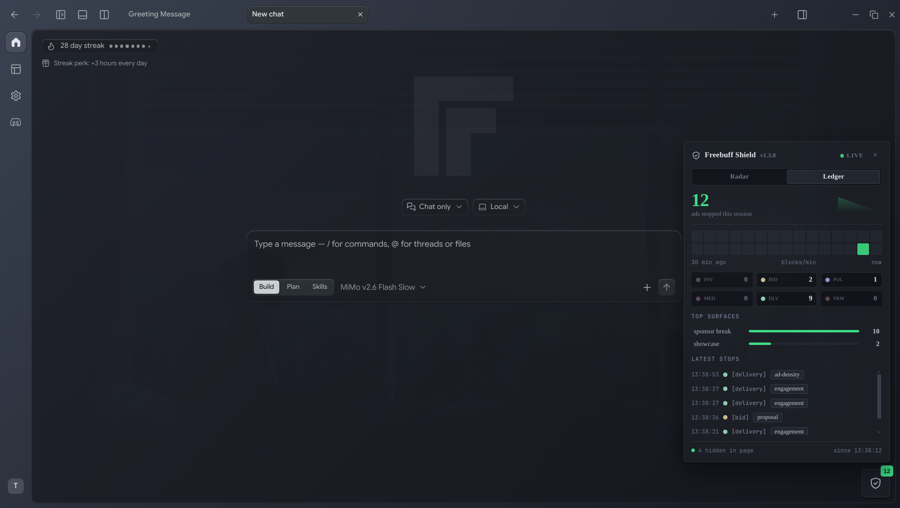

<div align="center">
  

  # Freebuff Ads Remover

  **Every ad in Freebuff Desktop — gone. Network kills, CSS burial, and a live shield dashboard counting every stop.**

  [](https://github.com/10xdev4u-alt/freebuff-ads-remover/actions)
  [](LICENSE)
  [](docs/INSTALLATION.md)
  [](CHANGELOG.md)
</div>

---



Freebuff Desktop shows ads to fund free access to AI models. This extension sits between the app and its ad server: requests die at the Electron session layer, anything server-rendered gets hidden by CSS, and the shield badge counts it all live.

- [Quickstart](#quickstart) · [How it works](#how-it-works) · [Configuration](#configuration) · [FAQ](#faq) · [Docs](#docs)

## What gets removed

| Surface | What disappears |
|---|---|
| SponsorBreak | Full-screen breaks |
| Billboard | Sidebar + panel units |
| Intermission | Between-turn ads |
| Spotlight / Showcase | Spotlight + showcase formats |
| Sponsored tasks / runs | Sponsored cards in timelines |
| In-chat sponsored cards | Server-rendered `sponsored-ad` creatives |
| Partner / Invitations | Partner ads, ad invites |
| Tracking | All impression / click / engagement endpoints |

Plus the **shield dashboard** in the app: blocks per funnel stage (`Inventory → Bid → Policy → Media → Delivery`, plus `Promo`), top surfaces, latest stops with timestamps, blocks-per-minute sparkline, and a DOM-hide counter.

## Quickstart

Requirements: Linux, a Freebuff Desktop **AppImage** install, Node.js ≥ 20 (patch step only).

```bash
git clone https://github.com/10xdev4u-alt/freebuff-ads-remover.git
cd freebuff-ads-remover
npm install
npm run build
./scripts/launch-freebuff.sh
```

Point your desktop icon at `scripts/launch-freebuff.sh` and forget about it — the launcher adopts newer updater payloads and re-patches automatically.

### Verify it works

```bash
# 1. set "logLevel": "debug" in ~/.config/freebuff-ads-remover/config.json
# 2. launch the app from your icon
grep "Blocked ad request" ~/.config/freebuff-ads-remover/extension.log | tail
```

One line per cancelled ad call (`/api/ad/policy`, `/api/ad/impression`, …). The
shield badge counts them live too.

> Do not pass `--remote-debugging-port` to Freebuff `>= 0.0.186`: the app ships
> its own scoped CDP bridge and exits immediately when the app-wide flag is
> present, so `scripts/verify-remover.mjs` and `scripts/screenshot-dashboard.mjs`
> only work on older builds.

Then click the shield badge (bottom-right of the app) to open the dashboard.

After a Freebuff update, check that no ad route slipped through:

```bash
npm run audit -- /tmp/freebuff-ads-remover-extract/squashfs-root/resources
# -> 41/41 ad routes blocked
```

It scrapes every `/api/...` route out of the new orchestrator and renderer bundle,
keeps the ad-related ones, and fails with the list of any the interceptor misses.

## How it works

```
Your App → Extension intercepts → Ad requests blocked → Clean UI
                    ↓
              Non-ad requests pass through normally
```

Electron ignores `--require`, `NODE_OPTIONS` and `--app` for packaged apps, so the launcher extracts the AppImage, repacks `app.asar` with a loader prepended to `electron/main.cjs` — the untouched archive is preserved as `app.asar.orig`. (Since `0.0.186` Freebuff enables the Electron `OnlyLoadAppFromAsar` fuse, so an unpacked `app/` directory is rejected at boot.) The extension then hooks `session.webRequest.onBeforeRequest` before the app boots. Details: [docs/ARCHITECTURE.md](docs/ARCHITECTURE.md).

## Configuration

File: `~/.config/freebuff-ads-remover/config.json` — hot-reloads, every key optional.

<details>
<summary>Full reference (click to expand)</summary>

```jsonc
{
  "enabled": true,       // master toggle
  "blockTracking": true, // impression / click / engagement endpoints
  "cssFallback": true,   // hide ad containers via CSS safety net
  "dashboard": true,     // in-app shield panel (badge + stats)
  "surfaces": {
    "sponsorBreak": true,
    "billboard": true,
    "intermission": true,
    "spotlight": true,
    "showcase": true,
    "sponsoredTask": true,
    "sponsoredRun": true,
    "partner": true,
    "invitation": true,
    "sponsoredCard": true
  },
  "logLevel": "info",    // debug | info | warn | error
  "logToFile": true
}
```

</details>

Every key: [docs/CONFIGURATION.md](docs/CONFIGURATION.md).

## FAQ

<details>
<summary>Do I need to do anything when Freebuff updates?</summary>

No. Restart the app from your icon — the launcher adopts the newer payload and re-patches it by itself.

</details>

<details>
<summary>The dashboard disappeared after an update — is it broken?</summary>

Same cause, same fix: the updater relaunched Freebuff without the patch. One icon restart brings the shield back.

</details>

<details>
<summary>How do I prove blocking is active?</summary>

Run the verifier above (expects `PASS`), or set `"logLevel": "debug"` and watch `Blocked ad request:` lines in `~/.config/freebuff-ads-remover/extension.log`.

</details>

<details>
<summary>How do I turn off just the dashboard?</summary>

Set `"dashboard": false`. Blocking keeps working; the badge unmounts.

</details>

<details>
<summary>Does it modify my Freebuff install?</summary>

No. The AppImage file is never touched — the patch applies to an extracted copy under `/tmp`, with the original archive preserved as `app.asar.orig`. See [Uninstall](docs/INSTALLATION.md#uninstall).

</details>

<details>
<summary>Does the extension phone home?</summary>

No. Zero network calls of its own — local filtering, CSS hiding, file logging. See [SECURITY.md](SECURITY.md).

</details>

<details>
<summary>Which Freebuff versions work?</summary>

AppImage builds. Verified live on `0.0.169`, `0.0.170` and `0.0.186`; the launcher re-patches each new payload automatically.

</details>

## Docs

| Guide | Contents |
|---|---|
| [Installation](docs/INSTALLATION.md) | Launcher, manual launch, verification, troubleshooting, uninstall |
| [Configuration](docs/CONFIGURATION.md) | Every config key, per-surface table |
| [Architecture](docs/ARCHITECTURE.md) | Components, data flow, updater survival |
| [Research](docs/RESEARCH.md) | Reverse-engineering notes |
| [Changelog](CHANGELOG.md) | Release history (current: `1.3.0`) |
| [Security](SECURITY.md) | Supported versions, private reporting |
| [Live site](https://10xdev4u-alt.github.io/freebuff-ads-remover/) | Landing page with interactive shield demo |

## Development

```bash
npm install
npm run build
npm test            # vitest, 163 tests
npm run lint
npm run typecheck
npm run test:coverage  # 80% threshold enforced
```

See [CONTRIBUTING.md](CONTRIBUTING.md) for the workflow, and the [landing page](index.html) regen notes after dashboard changes.

## License

MIT — see [LICENSE](LICENSE).

---

<div align="center">

**[Repo](https://github.com/10xdev4u-alt/freebuff-ads-remover)** &nbsp;·&nbsp; **[Site](https://10xdev4u-alt.github.io/freebuff-ads-remover/)** &nbsp;·&nbsp; **[Issues](https://github.com/10xdev4u-alt/freebuff-ads-remover/issues)**

</div>
